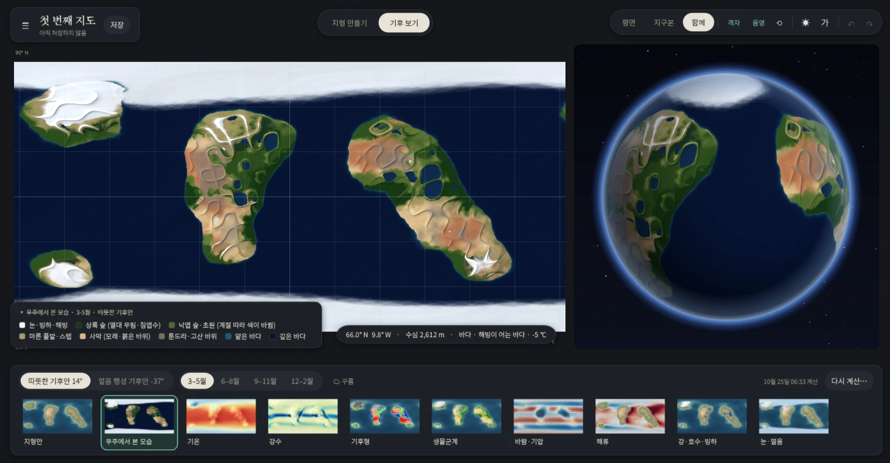

# Map

지구 크기 행성의 지형을 직접 그리고, 그 지형에서 생기는 계절 기후를 계산해 보는 Windows 프로그램입니다.

## 설치

[Releases](../../releases)에서 `Map-Setup-날짜.exe`를 받아 실행합니다. Windows 10/11 64비트에서 돌아가고, 따로 설치할 프로그램은 없습니다.
서명하지 않은 설치 파일이라 처음 실행할 때 "Windows의 PC 보호" 창이 뜰 수 있습니다. "추가 정보" → "실행"을 누르면 됩니다.

## 할 수 있는 것

- 지구본과 평면 지도에서 붓으로 지형을 그립니다. 목표 고도로 맞추기, 부드럽게, 산맥 그리기 붓이 있습니다.
- 그린 지형으로 기후를 계산합니다(3~5분). 기온, 강수, 쾨펜 기후형, 생물군계, 기압과 바람, 해류, 눈과 해빙, 구름을 계절별로 볼 수 있습니다.
- 지도를 누르면 그곳의 월별 기온·강수와 기후형을 보여 줍니다.
- 지도를 저장하면(.map) 계산한 기후도 같은 파일에 들어갑니다.

| 키 | 기능 |
|---|---|
| 1 / 2 / 3 / 4 / 5 | 둘러보기 / 목표 고도 / 부드럽게 / 산맥 / 고도 가져오기 |
| Tab | 지형 편집 ↔ 기후 보기 |
| 왼쪽 끌기 | 고른 붓으로 그리기 |
| 오른쪽 끌기, 휠 | 시점 옮기기, 확대·축소 |
| Ctrl+Z / Ctrl+Y | 되돌리기 / 다시 하기 |
| Ctrl+S / Ctrl+Shift+S / Ctrl+O | 저장 / 다른 이름으로 저장 / 열기 |
| Ctrl + = / Ctrl + − / Ctrl + 0 | 글자 크게 / 작게 / 100% |

## 기후 계산에 대해

창작용 단순 계절 기후 모형으로 계산한 근삿값입니다. 기후 격자 한 칸이 약 480 km이고, 지도에 칠하는 기온과 비는 그 안에서 지형 높이와 바람을 따라 다시 나눕니다.
실제 기후 연구나 예보에 쓰는 결과가 아닙니다. 행성 조건(크기, 자전, 공전, 기울기, 대기)은 지구와 같게 고정되어 있습니다.

## 직접 빌드하기

.NET 10 SDK가 필요합니다.

~~~powershell
.\build.ps1 -Check   # 빌드하고 검사 실행
.\build.ps1 -Run     # 빌드하고 앱 실행
~~~

- 저장소에서 빌드한 앱은 기후 계산을 WSL(Ubuntu)에서 돌립니다. 저장소 안 `.runtime/seasonal-engine`에 numpy, scipy, matplotlib이 든 Python 3.12 가상 환경이 있어야 합니다.
- `package.ps1`은 Python과 기후 모형까지 넣은 설치 파일을 만듭니다. Inno Setup 6이 `artifacts\package-cache\innosetup`에 있어야 합니다.

## 폴더

- `src/TheGarden.Core` — 지형, 붓, 지도 파일, 기후 결과 읽기
- `src/TheGarden.Desktop` — 앱 화면(WPF)
- `tools/climate/worldclimate` — 기후 모형(Python)
- `tests` — 검사
- `installer` — 설치 프로그램 설정
